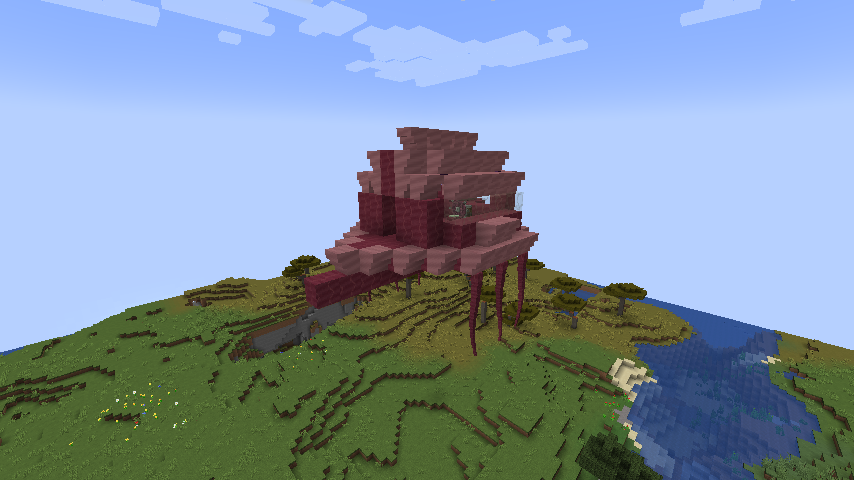
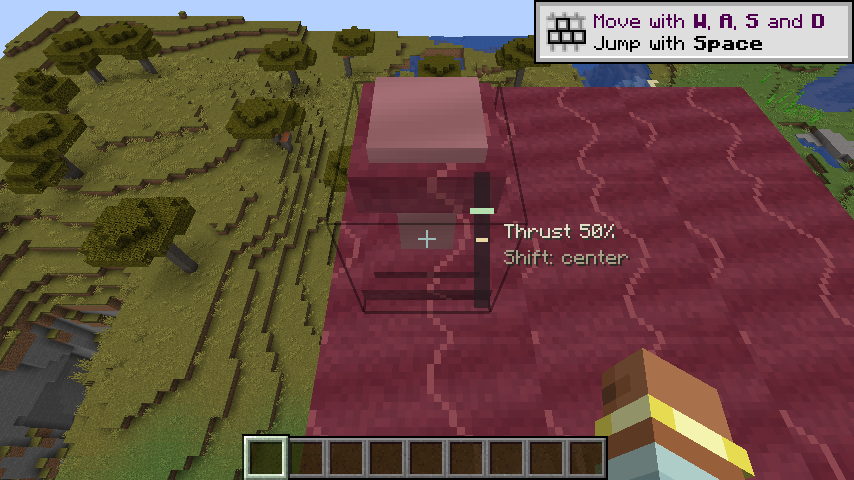

# Create Bioships

Living airships for Minecraft 1.21.1, NeoForge 21.1.266, and Java 21.

## Raising a bioship

1. Place a **Living Ship Core** on level ground with room around it. It automatically becomes a Sable physics object when placed. The core and living structure cannot be manually disassembled with Aeronautics/Simulated assemblers or extracted into Create contraptions. Mining and damage remain possible.
2. Put Biomancy machines within three blocks of the eye. Every second it assimilates nearby machines, retaining their block entities and unrelated inventory. Detached machines are drawn into a vacant attachment beside the core. Machines already attached to the ship extend assimilation to their immediate neighbors. Eligible machines are listed in `create_bioships:assimilable_machines`.
3. Assimilate a **Biomancy Maw Hopper** to provide a mouth. The eye itself cannot eat. Right-click the integrated maw with food or amalgam; other interactions still use Biomancy’s normal machine behavior.
4. Accumulate **64 biomass** to grow the dinghy. Nearby Biomancy flesh and construction materials stored in integrated machines count toward this total, with **no hunger restoration or trust reward**. Only the amount needed is consumed; unrelated contents remain. Construction tags are `create_bioships:construction_flesh` and `create_bioships:construction_biomass`. The ship never harvests its own attached tissue for food.
5. Feeding fresh meat through the maw also supplies growth material and nutrition. **Rotten flesh is poisonous**, as are swallowed zombies. Skeletons supply no food. Keep roughly **9 blocks of width, 15 of length, and 7 above the core** clear. Growth pauses at obstructions instead of overwriting them. The lower body forms at core height, with a raised cabin and rear boarding steps, so growth does not require an automatic climb.
6. Feed **8 Levitite Blend Buckets** through the maw to incorporate the fluid amalgam. Empty buckets are returned. Each dose develops a luminous, veined organ beneath the hull after the body matures. **Flight requires the finished body and all eight organs**; biomass alone never supplies lift. Solid levitite blocks are not food. The ingredient is configurable through `create_bioships:levitite_amalgam`; Aeronautics 1.3.2 names its fluid “Levitite Blend.”
7. Board through the living valve door. The tapered carapace, vaulted cabin, translucent dermal windows, enhanced captain’s cradle, pulsing lights, and blinking active core replace the old glass box layout. Existing completed prototype ships are not rebuilt automatically; use a fresh core for this layout.



The core and door are creative-only for now. There are no crafting recipes.

## Physical cockpit controls

- **Thrust tendon:** hold right-click and move the mouse vertically. Positive settings drive ahead, negative settings reverse, and Shift centers the control. The flesh handle moves in the world. No screen opens.
- **Buoyancy tendon:** the same interaction combines ascent, descent, and neutral altitude hold. Set positive trim to lift off after amalgam incorporation.
- **Helm:** Simulated’s actual steering wheel bundled with Aeronautics, with its native hold interaction and overlay. The grown wheel uses crimson fungal wood.
- **Hunting nerve:** a physical, latching pad enables local food hunting. Redstone can activate it too. It starts off.
- **Rest:** empty-hand clicking the core rests or wakes the creature. Sneak-click inspects its needs. A cooperative resting ship retains developed buoyancy while suspending commands and hunting. An aggressive ship can refuse to rest.

A small signed tendon readout appears while interacting **only when wearing aviation or Create goggles**. Thrust and vertical trim persist; server packets validate reach through Sable’s moving structure transform, block type, and setting bounds.



## Appetite and trust

Larger bodies need more food: each second consumes `1 + floor((body blocks - 1) / 64)` satiety units, based on the actual loaded structure. Fresh meat restores 70 units, up to 1200. Stored construction tissue is not sustenance. Hunger drains while the ship is loaded.

Starvation lowers trust, which ranges from −100 to +100. Below zero, the ship becomes aggressive, refuses helm commands, and attacks nearby living targets even with hunting disabled. Feeding fresh food rebuilds trust. Striking the eye lowers trust.

Permitted hunting seeks visible food locally and uses the flagella to capture prey. A consumed creature restores 80 units, less than two hand-fed meat items, and gives no trust reward. Farm animals, villagers, and other players may become prey. A cooperative ship excludes its first feeder, passengers, creative/spectator players, invulnerable entities, and tame pets; aggression also threatens its former captain and pets. Skeletons can be attacked defensively but are never eaten for nutrition. Zombies poison the creature: toxins drain satiety, reduce trust, and weaken its response until they wear off. Poison and captain identity persist across saves.

## Living propulsion

Six articulated flagella propel and steer the rigid body without mechanical propellers. Intact limbs contribute swimming strength; grabbing occupies a limb, and losing limbs reduces propulsion. Developed amalgam organs supply buoyancy separately. Destroying an organ disables flight until its tissue is repaired; destroying every flagellum leaves a flight-capable ship without swimming thrust.

Tentacles select visible targets within six blocks, pull with bounded velocity, and bite at an actual mouth. Destroying or removing the mouth prevents prey nutrition and hand feeding. Captures time out or release when targets leave reach or a cooperative ship rests. Local scent-following is an initial behavior, not full obstacle navigation.

## Development

```sh
./gradlew build
./gradlew runGameTestServer
./gradlew runClient
```

Unit tests cover separate growth/flight thresholds, construction without nutrition, size-dependent appetite, negative trust, hunting efficiency, poison, persistence bounds, and flagellum strokes. Development-only GameTests cover real Sable assembly, machine assimilation and inventory retention, disassembly protection, grounded growth, signed physical controls, native steering, propulsion, organ development, mouth-gated prey feeding, and cabin lighting. Test fixtures are excluded from the shipped JAR. GameTests use a fresh world under `build/gametest-run`, separate from client/server worlds, and place ships at separate locations near the origin.

| Dependency | Version | CurseForge file |
| --- | --- | --- |
| Sable | 2.0.6 | 9043865 |
| Create Aeronautics | 1.3.2 | 8763471 |
| Create | 6.0.10 | 7963363 |
| Biomancy Reforged | 2.9.11.0 | 9429985 |
| GeckoLib (required by Biomancy) | 4.9.3 | 8893490 |

Physics tests run near the origin because the native simulation loses horizontal precision at the test runner’s randomized multi-million-block locations. Further growth stages, limb regeneration, and advanced navigation remain future work.
