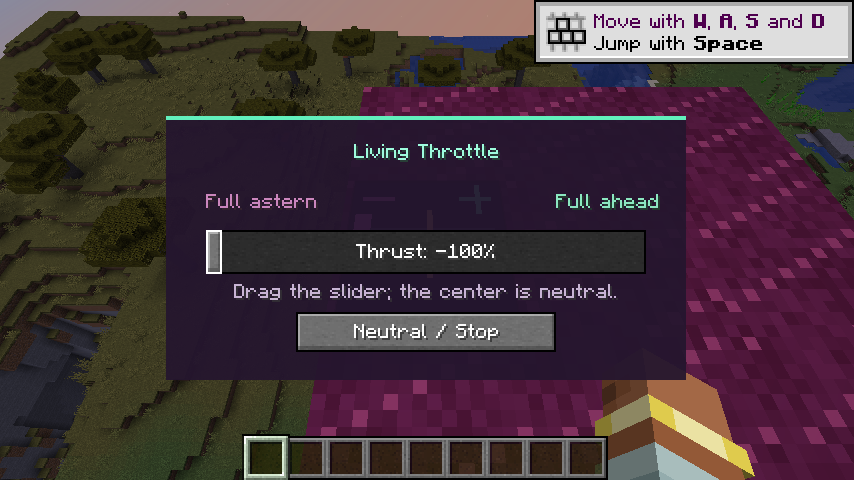

# Create Bioships

A biological airship for **Minecraft 1.21.1, NeoForge 21.1.266, Java 21**. A creative-only core awakens inside a Sable structure, eats materials, and grows a living body.

## Raise a ship

1. Take **Living Ship Core** from the **Create Bioships** Creative tab. There is no recipe yet.
2. Place it in open space and assemble **only the core** using Sable’s existing assembly tools. The dormant, unassembled core cannot eat.
3. Feed the awakened core **8 levitite** and **64 meat or rotten flesh**, one item per interaction. The first levitite enables buoyancy. A hatchling that landed rises gently to make room for its appendages. Pearlescent levitite works too.
4. Allow a **9-by-11** footprint, **4 blocks above** the core for the roof, and **6 blocks below** for swimming tentacles. The connected body grows over about **22 seconds**. Obstructions pause growth; it never clears existing blocks to make room.
5. Board through the rear entrance. The roofed cockpit has purple windows, a skylight, a clear aisle, a fleshy perch with Create’s riding behavior, and four pulsing bioluminescent lights.
6. Feed **32 additional meat or rotten flesh** after the first body finishes to develop its underside mouth. Mouth development persists and waits for a clear growth cell. A destroyed mouth does not regrow automatically.

This layout is larger than the first prototype. **Grow a fresh core to try it**: existing ships are not automatically rebuilt. Legacy block IDs remain registered so old prototype worlds can load.

## Cockpit controls

- **Throttle:** a thin emissive panel beside the perch. Right-click to open its draggable slider. **−100%** is full astern, **0%** is neutral, and **+100%** is full ahead. The screen has a neutral button; sneak-clicking the panel also stops thrust. Its illuminated marker follows the setting. Reverse is integrated here; there is no reverse pad.
- **Helm:** the actual **Simulated steering wheel shipped with Aeronautics**, rather than a separate click-to-step imitation. Hold the wheel and move the mouse using its native interaction, angle settings, and overlay. The dependency’s normal goggles/overlay rules apply. The grown wheel uses a crimson fungal-wood finish. Its angle steers the Sable body.
- **Altitude:** two small nerve pads on the starboard side command ascent/descent. Empty-hand clicking latches them; adjacent redstone activates them too. There are no strafe controls in the new cabin.
- **Rest:** empty-hand clicking the core pauses propulsion, steering, autonomous food-seeking, and tentacle attacks/grabbing while retaining buoyancy. Sneak-click the core to inspect needs without toggling rest.

All propulsion comes from the living appendages. There is no mechanical propeller. Throttle, helm, and nerve states persist with the structure. Slider messages are validated on the server against range, dimension, block type, and allowed values.



## Functional flagella

The six root organs render articulated travelling waves instead of hanging static block columns. The wave reverses with reverse throttle. Intact, unoccupied flagella contribute to propulsion and steering; losing limbs reduces performance, and a limb holding prey is temporarily unavailable for swimming. Levitite provides buoyancy independently, so losing every flagellum leaves the ship afloat but unable to propel itself.

Tentacles can reach nearby entities below the ship, pull them upward, and attack them. They target nearby hostile monsters defensively and edible creatures when hungry. Targets must be visible and within reach; different limbs reserve different prey. Grabs time out or release when targets leave reach, the limb is removed, or the ship rests. The system uses bounded pulling velocity, not permanent entity attachments or gravity changes.

Once the mouth has developed and is physically present, tentacles bring prey toward it. A bite that kills an edible target nourishes the ship. Without a mouth, tentacles can grab and attack but cannot turn living prey into nutrition. The `create_bioships:edible_entities` entity-type tag defines edible animals and undead. Players, passengers, invulnerable entities, and tamed animals are excluded from prey selection.

## Hunger and temperament

Hunger decreases while the structure is loaded. Meat restores 70 seconds of satiety; rotten flesh restores 40, up to 20 minutes. Its diet is defined by `create_bioships:biomass`. After growth and mouth development, food continues to maintain the creature.

Feeding improves trust; striking the core lowers it. Hungry or wary ships respond more slowly. Grumpy ships hesitate periodically, while buoyancy remains active. Uncommanded hungry ships can also approach visible dropped meat. These are initial autonomous behaviors, not full navigation or a finished companion AI.

## Development and checks

```sh
./gradlew build
./gradlew runGameTestServer
./gradlew runClient
```

Eight unit tests cover needs, resource thresholds, bounded state, and flagellum stroke/availability. Seven development-only GameTests cover dormant feeding, signed slider validation, redstone altitude controls, enclosed growth and persistence, actual forward/reverse motion and native-helm steering, limb loss, obstruction protection, mouth development, grabbing, attacks, prey nutrition, stable hover, and pulsing cabin lights. Test fixtures in `src/gameTest` are excluded from the shipped JAR.

| Dependency | Version | CurseForge file |
| --- | --- | --- |
| Sable | 2.0.6 | 9043865 |
| Create Aeronautics | 1.3.2 | 8763471 |
| Create | 6.0.10 | 7963363 |

Sable provides moving block structures and rigid-body simulation. Aeronautics provides levitite and the bundled Simulated helm/assembly interaction. Create provides the perch’s riding behavior and redstone automation options.

Physics tests run near the origin: the native simulation showed horizontal precision loss at the runner’s randomized multi-million-block coordinates. Further growth stages, limb regeneration, advanced navigation, and more complex personalities remain future work.

Client smoke checks also covered model loading, articulated flagellum rendering, the cockpit instruments, opening the signed slider, and a full-reverse update verified on the server.
